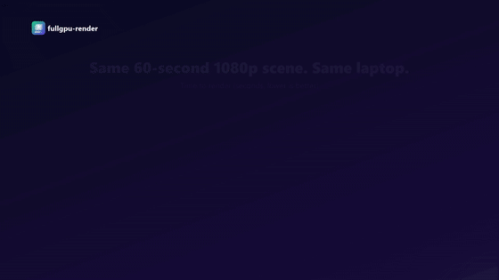
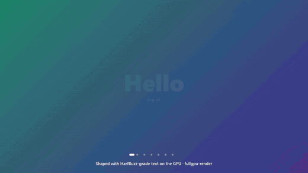
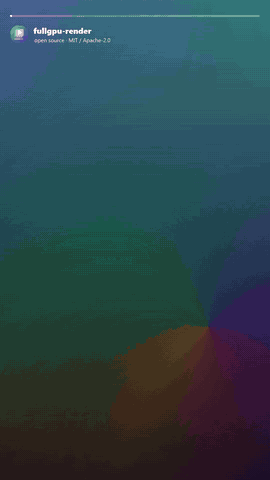

<p align="center">
  
</p>

<h1 align="center">fullgpu-render</h1>

<p align="center">
  <b>Write videos in code. Render them entirely on the GPU.</b><br>
  A Remotion-style API (<code>spring</code>, <code>interpolate</code>, sequences) with a native engine:
  NVDEC → wgpu → NVENC. No headless browser, no screenshots, no CPU encode.
</p>

<p align="center">
  <a href="https://github.com/WassimAarab08/fullgpu-render/actions/workflows/ci.yml"></a>
  
  
  
  
</p>

<p align="center">
  
</p>

<p align="center"><b>23× faster than Remotion</b> on the same scene and laptop · every example below renders in 2–4 seconds</p>

---

## Examples

Every clip here is a single `.mjs` file in [`examples/`](examples/), rendered with `npm run render -- <file> <out.mp4>`.

<table>
<tr>
<td width="50%"><br>
<b><a href="examples/benchmark-story.mjs">benchmark-story</a></b> — data story with spring-driven bars, counting labels and a punchline. 270 frames in 2.0 s.</td>
<td width="50%"><br>
<b><a href="examples/multilingual-titles.mjs">multilingual-titles</a></b> — kinetic type in 7 scripts (Arabic RTL, Chinese, Cyrillic…) over color-shifting gradients. 264 frames in 1.6 s.</td>
</tr>
<tr>
<td><br>
<b><a href="examples/social-vertical.mjs">social-vertical</a></b> — 9:16 clip: full-bleed video (cropped like <code>object-fit: cover</code>), story progress bar, one-word-at-a-time captions. 300 frames in 3.1 s.</td>
<td><b><a href="examples/app-promo.mjs">app-promo</a></b> (top of this page) — product promo: two-line headline with springs, CTA with glow, a phone rising in and a fitness app UI built from shapes (cards popping in, a step counter, animated bars). 240 frames in 3.2 s.<br><br>
<b><a href="examples/launch-video.mjs">launch-video</a></b> — the project's own 24-second launch video (4:5), which plays the other examples inside cards. 720 frames in 4.7 s. Download the MP4s from the <a href="https://github.com/WassimAarab08/fullgpu-render/releases/latest">latest release</a>.</td>
</tr>
</table>

## Write a video

```js
// hello.mjs
import { composition, rect, text, group, spring, interpolate } from "./sdk/index.mjs";

export default composition({ width: 1920, height: 1080, fps: 30, durationInFrames: 90 }, ({ frame, fps }) => {
  const pop = spring({ frame, fps, config: { damping: 12 } });
  return [
    rect({ x: 0, y: 0, width: 1920, height: 1080, gradient: { from: "#0B0F24", to: "#26136B", angle: 135 } }),
    group({ x: 960, y: 540, scale: 0.6 + 0.4 * pop, opacity: pop }, [
      text({ text: "Hello, GPU", x: 0, y: 0, size: 160, weight: 900, color: "#7CF3CF" }),
    ]),
    text({ text: "rendered with fullgpu-render", x: 960, y: 700, size: 40, color: "#C9C6F5",
           opacity: interpolate(frame, [20, 40], [0, 1], { extrapolateLeft: "clamp", extrapolateRight: "clamp" }) }),
  ];
});
```

```bash
npm run render -- hello.mjs out/hello.mp4
```

If you know Remotion you already know the model: a composition is a function of the frame. `interpolate`,
`spring`, `measureSpring`, `Easing` and `interpolateColors` keep Remotion's signatures, and the test suite checks
them value by value against Remotion's own output. The implementation is written from scratch.

| Building block | What it does |
|---|---|
| `rect` | Rounded rectangle with solid color or linear gradient (CSS angles) and a soft drop shadow |
| `text` | Shaped text (bidi, Arabic, CJK, fallback fonts), weight, wrapping, pill background, scale |
| `image` | PNG/JPEG/WebP with rounded corners |
| `video` | Clip with `from`, `durationInFrames`, `startFrom`, `playbackRate` and `fit: "cover"` cropping, decoded by NVDEC |
| `group` | Translate, scale and fade a subtree |
| `sequence` | Time-shifted subtree, like Remotion's `<Sequence>` |

## What it improves

Remotion and similar tools render each frame in a headless browser, take a screenshot, pipe it to FFmpeg and encode
it on the CPU. On a laptop with an RTX 4050, that pipeline leaves the NVIDIA GPU **at 0 %** and renders at
**~9 fps**. fullgpu-render keeps every frame on the GPU:

```
 clips ──NVDEC──▶ GPU textures ──wgpu (WGSL compositor)──▶ GPU canvas ──RGB→NV12 on GPU──▶ NVENC ──▶ MP4
```

Measured on the same 60-second 1080p scene (two screen recordings in device frames, animated Chinese and Arabic
titles, a transition) on the same laptop:

| Renderer | Wall time | fps | Speed-up |
|---|---:|---:|---:|
| Remotion 4.0.539 (`--gl=angle --concurrency=8 --crf=20`) | 204.1 s | 8.8 | 1× |
| Remotion + `--hardware-acceleration=required` (NVENC) | 172.8 s | 10.4 | 1.18× |
| **fullgpu-render, browser engine** (WebGPU + WebCodecs) | 13.2 s | 136 | **15×** |
| **fullgpu-render, native engine** (Rust + wgpu + NVDEC/NVENC) | **8.7 s** | **206** | **23×** |

A real-world check: a 3 min 47 s explainer (12 scenes, 42 clips at different speeds, 69 captions, censored
regions, voice-over) took **~10 min** in Remotion and **43 s** in the native engine.

| | NVIDIA 3D / NVDEC / NVENC | Intel iGPU | CPU |
|---|---|---|---:|
| Remotion | 0 % / 0 % / 0 % | 3D 5 % (Chrome draws here) | 45 % |
| Browser engine | 15 % / 45 % / 0 % | media engine 54 % (QuickSync encodes) | 25 % |
| Native engine | 85 % / 55 % / 45 % | — | 67 % |

- **Remotion is pipeline-bound, not compute-bound.** CPU stays under 50 % while the discrete GPU idles; NVENC only
  removes the last step (1.18×).
- **Browsers can't reach NVENC on Optimus laptops.** Chrome composes on the RTX, but Media Foundation picks the Intel
  QuickSync encoder (`chrome://media-internals`), capped around 172 fps.
- **The native engine still has headroom.** The GPU is half idle; the CPU time is spent copying frames through
  ffmpeg pipes, which CUDA↔Vulkan interop would remove (see the roadmap).

## How it works

- **The SDK** ([`sdk/`](sdk/)) evaluates your composition frame by frame and compiles it to a compact draw list:
  shapes, texts, images and video streams (one NVDEC decoder per clip, with its own playback rate).
- **One shader, two runtimes.** [`shaders/compose.wgsl`](shaders/compose.wgsl) runs unchanged in WebGPU (browser
  engine) and wgpu (native engine). Rounded corners, soft shadows and gradients are signed-distance fields.
- **Native engine** ([`native/`](native/)):
  - ffmpeg NVDEC with GPU scaling (`scale_cuda`) per clip;
  - wgpu composition, then RGB→NV12 on the GPU, so only 1.5 bytes per pixel are read back;
  - a 3-slot readback ring feeding ffmpeg NVENC;
  - voice-over clips mixed in parallel and muxed without re-encoding.
- **Text without a browser:** [cosmic-text](https://github.com/pop-os/cosmic-text) (rustybuzz shaping, bidi, system
  font fallback, centered wrapping).

## Quick start

Requirements: an NVIDIA GPU, ffmpeg with `h264_nvenc` and `cuda` on the `PATH`, Rust 1.87+, Node 22+. Developed on
Windows 11; the native engine should also work on Linux but is untested there.

```bash
git clone https://github.com/WassimAarab08/fullgpu-render
cd fullgpu-render
npm install
npm run build        # native engine
npm run media        # synthetic test clips in media/ (used by the video examples)
npm run examples     # renders the four examples into out/
```

## Reproducing the benchmark

```bash
cd remotion-baseline && npm install && cd ..    # only for the Remotion rows
npm run bench                                   # ~20 min, results in out/bench/*.json
```

- [`tools/bench.mjs`](tools/bench.mjs) records wall time, `nvidia-smi` (GPU, NVENC, NVDEC) and CPU. Without
  `BENCH_ENGINES=0` it also samples the Windows *GPU Engine* counters, which see the Intel iGPU.
- The table was measured on real screen recordings (not distributed). The synthetic clips from `npm run media` are
  heavier to decode, so absolute numbers will differ.
- Laptop GPUs throttle: check `nvidia-smi --query-gpu=clocks.sm,clocks_event_reasons.active --format=csv` first.
  With power or thermal capping active, the same build runs about 2× slower.

## How it compares

| Project | How it draws | Hardware decode / encode | Text (RTL, CJK) | License |
|---|---|---|---|---|
| Remotion | DOM in headless Chrome + screenshot | Encode: NVENC/VideoToolbox. Decode: CPU | Chrome | Source-available (paid for companies of 4+) |
| HyperFrames | HTML/GSAP in headless Chrome | Encode: NVENC/QSV/VAAPI/VT. Decode: frames pre-extracted to JPEG | Chrome | Apache-2.0 |
| Revideo / Motion Canvas | Canvas 2D in a browser | FFmpeg; no documented HW encode | Canvas | MIT |
| Smelter | Native GPU compositor | Vulkan Video; Linux/macOS binaries | Not verified | Custom, not OSI |
| GStreamer / FFmpeg filter graphs | `cudacompositor`, `overlay_cuda`, libplacebo | NVDEC/NVENC | Pango/HarfBuzz, rasterized on CPU | LGPL/GPL |
| **fullgpu-render** | **wgpu / WebGPU, shared WGSL** | **NVDEC → NVENC (native)** | **cosmic-text (bidi, Arabic, CJK)** | **MIT OR Apache-2.0** |

## Status and roadmap

Early preview: the API may change. Today it covers shapes, gradients, shadows, text, images, video and sequences.
It does not run arbitrary HTML/CSS.

- [x] Remotion-compatible animation core (`interpolate`, `spring`, `Easing`, `interpolateColors`)
- [x] Composition SDK: `rect`, `text`, `image`, `video`, `group`, `sequence`
- [x] Native engine with NVDEC/NVENC, gradients, `object-fit: cover`, voice-over mixing
- [ ] JSX/React components on top of the SDK (`<AbsoluteFill>`, `<Sequence>`, `useCurrentFrame()`)
- [ ] Flexbox layout and text alignment
- [ ] Rotation, masks, blur and blend modes
- [ ] Streaming draw lists from Node to Rust and parallel segment rendering
- [ ] Zero-copy decode/encode (CUDA/D3D12↔Vulkan external memory)
- [ ] Live preview in the browser with a timeline
- [ ] QuickSync / VideoToolbox / AMF backends

## Contributing

Issues and PRs are welcome. Read [CONTRIBUTING.md](CONTRIBUTING.md) and the [Code of Conduct](CODE_OF_CONDUCT.md).
Security reports go through [SECURITY.md](SECURITY.md).

## License

Licensed under either of [MIT](LICENSE-MIT) or [Apache-2.0](LICENSE-APACHE), at your option.
