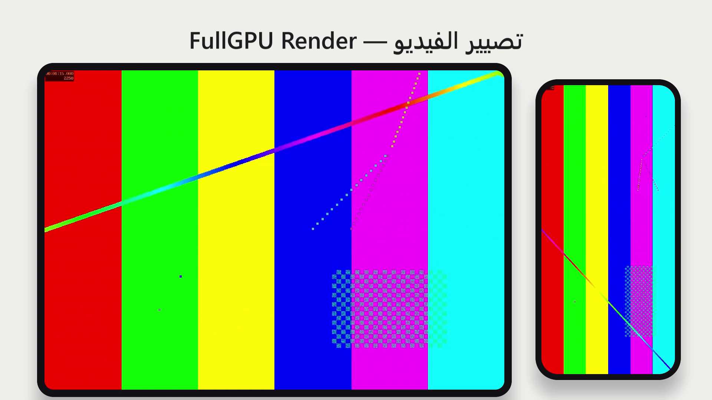

<h1 align="center">fullgpu-render</h1>

<p align="center">
  <b>Programmatic video rendering that stays on the GPU end to end.</b><br>
  NVDEC → wgpu / WebGPU → NVENC. No DOM, no screenshots, no CPU encode.
</p>

<p align="center">
  <a href="https://github.com/WassimAarab08/fullgpu-render/actions/workflows/ci.yml"></a>
  
  
  
</p>

---

## What it improves

Code-defined video tools like Remotion render each frame in a headless browser, take a screenshot, pipe it to
FFmpeg and encode it on the CPU. On a laptop with an RTX 4050 that pipeline leaves the NVIDIA GPU **at 0 %** and
renders at **~9 fps**.

fullgpu-render keeps every frame on the GPU:

```
 source clips ──NVDEC──▶ GPU textures ──wgpu (WGSL compositor)──▶ GPU canvas ──RGB→NV12 (GPU)──▶ NVENC ──▶ MP4
```

On the same machine and the same 60-second 1080p scene (two screen recordings in rounded device frames with
shadows, animated Chinese and Arabic titles, a transition):

| Renderer | Wall time | fps | Speed-up |
|---|---:|---:|---:|
| Remotion 4.0.539 (`--gl=angle --concurrency=8 --crf=20`) | 204.1 s | 8.8 | 1× |
| Remotion + `--hardware-acceleration=required` (NVENC) | 172.8 s | 10.4 | 1.18× |
| **fullgpu-render, browser engine** (WebGPU + WebCodecs) | 13.2 s | 136 | **15×** |
| **fullgpu-render, native engine** (Rust + wgpu + NVDEC/NVENC) | **8.7 s** | **206** | **23×** |

All three outputs show the same frame (SSIM 0.98 against Remotion). Projected to a 4-minute video:
~14 min with Remotion, **~35 s** with the native engine.



<sub>Sample frame from the native engine with the synthetic test media in this repo.</sub>

## Why it is faster

Measured with `nvidia-smi` and the Windows GPU-engine counters during the runs above:

| | NVIDIA 3D / NVDEC / NVENC | Intel iGPU | CPU |
|---|---|---|---:|
| Remotion | 0 % / 0 % / 0 % | 3D 5 % (Chrome draws here) | 45 % |
| Browser engine | 15 % / 45 % / 0 % | media engine 54 % (QuickSync encodes) | 25 % |
| Native engine | 85 % / 55 % / 45 % | — | 67 % |

- **Remotion is pipeline-bound, not compute-bound.** CPU stays under 50 % and the discrete GPU is idle. Turning on
  NVENC only removes the last step (1.18×).
- **The browser engine cannot reach NVENC on Optimus laptops.** Chrome composes on the RTX and decodes with
  `D3D11VideoDecoder` there, but Media Foundation picks the **Intel QuickSync** encoder MFT
  (`chrome://media-internals`), which caps encoding at ~172 fps.
- **The native engine still has headroom.** The GPU is half idle. The 67 % CPU is spent copying frames through
  ffmpeg pipes; CUDA↔Vulkan external memory would remove those copies (see [roadmap](#roadmap)).

## How it works

- **One scene model, two engines.** [`scene/scene.mjs`](scene/scene.mjs) turns a scene into a per-frame list of
  draw primitives (rounded rects with soft shadows, video screens, text) plus the video streams and voice-over clips.
- **One shader, two runtimes.** [`shaders/compose.wgsl`](shaders/compose.wgsl) runs unchanged in WebGPU (browser
  preview) and wgpu (native render). Only the video read differs: `texture_external` in the browser, NV12 planes
  in native.
- **Native engine** ([`native/`](native/)):
  - one ffmpeg NVDEC process per clip, with its own playback rate (`setpts` + `fps`) and GPU scaling (`scale_cuda`);
  - wgpu composition, then RGB→NV12 on the GPU, so only 1.5 bytes per pixel are read back;
  - a 3-slot readback ring feeding ffmpeg NVENC;
  - voice-over clips mixed and muxed in the same encoder process.
- **Text without a browser.** [cosmic-text](https://github.com/pop-os/cosmic-text) (rustybuzz shaping, bidi, system
  font fallback, centered wrapping) renders connected Arabic and Chinese like Chrome does.
- **Browser engine** ([`browser/`](browser/)): mediabunny demux → `VideoDecoder` → `importExternalTexture`
  (zero-copy) → WebGPU → `new VideoFrame(canvas)` → `VideoEncoder` → MP4.

## Quick start

Requirements: an NVIDIA GPU, ffmpeg with `h264_nvenc` and `cuda` on the `PATH`, Rust 1.87+, Node 22+. The browser
engine also needs Chrome. Developed on Windows 11; Linux should work for the native engine but is untested.

```bash
git clone https://github.com/WassimAarab08/fullgpu-render
cd fullgpu-render
npm install
npm run media                                   # synthetic test clips in media/ (~1 min)
npm run layout                                  # scene -> out/layout.json
cargo build --release --manifest-path native/Cargo.toml
native/target/release/fullgpu-render out/layout.json . out/native.mp4
node tools/verify.mjs out/native.mp4 --frames   # checks the MP4, saves frames at 10 s and 45 s
npm run render:browser                          # same scene with the browser engine -> out/browser.mp4
```

The native engine prints a JSON line with its metrics (`fps`, `decodeWaitMs`, `encodeWaitMs`, ...).

## Reproducing the benchmark

```bash
cd remotion-baseline && npm install && cd ..    # only needed for the Remotion rows
bash tools/run-bench.sh                         # ~20 min, results in out/bench/*.json
```

- [`tools/bench.mjs`](tools/bench.mjs) runs any command and records wall time, `nvidia-smi` (GPU, NVENC, NVDEC) and
  CPU. Without `BENCH_ENGINES=0` it also samples the Windows *GPU Engine* counters, which see the Intel iGPU.
- The table above was measured on real screen recordings, which are not distributed. The synthetic `testsrc2`
  clips from `npm run media` have several times the bitrate and are heavier to decode, so absolute numbers will differ.
- Laptop GPUs throttle. Check `nvidia-smi --query-gpu=clocks.sm,clocks_event_reasons.active --format=csv` before
  measuring; with power/thermal capping active, the same build runs about 2× slower.

## How it compares

| Project | How it draws | Hardware decode / encode | Text (RTL, CJK) | License |
|---|---|---|---|---|
| Remotion | DOM in headless Chrome + screenshot | Encode: NVENC/VideoToolbox. Decode: CPU | Chrome | Source-available (paid for companies of 4+) |
| HyperFrames | HTML/GSAP in headless Chrome | Encode: NVENC/QSV/VAAPI/VT. Decode: frames pre-extracted to JPEG | Chrome | Apache-2.0 |
| Revideo / Motion Canvas | Canvas 2D in a browser | FFmpeg; no documented HW encode | Canvas | MIT |
| Smelter | Native GPU compositor | Vulkan Video; Linux/macOS binaries | Not verified | Custom, not OSI |
| GStreamer / FFmpeg filter graphs | `cudacompositor`, `overlay_cuda`, libplacebo | NVDEC/NVENC | Pango/HarfBuzz, rasterized on CPU | LGPL/GPL |
| **fullgpu-render** | **wgpu / WebGPU, shared WGSL** | **NVDEC → NVENC (native)** | **cosmic-text (bidi, Arabic, CJK)** | **MIT OR Apache-2.0** |

None of the open-source options combines a code-defined scene, GPU composition, hardware decode and encode without
CPU round trips, and HarfBuzz-grade text. That gap is what this project explores.

## Status and limitations

This is a **research prototype**, not a product.

- **Primitives:** rounded rectangles with soft shadows, video screens and text. No arbitrary HTML/CSS.
- **Platform:** NVIDIA only for now; QuickSync, VideoToolbox and AMF paths are not wired.
- **Copies:** frames still cross the CPU between ffmpeg and wgpu.
- **Measurements:** from one laptop (i7-12650H, RTX 4050 Laptop, Windows 11, driver 617.42).

## Roadmap

- [ ] Zero-copy decode/encode: libav in-process plus CUDA/D3D12↔Vulkan external memory.
- [ ] Declarative timeline (layers, keyframes, easing) evaluated in Rust and compiled to WASM for browser preview.
- [ ] Parallel segment rendering (several NVENC sessions) with concatenation without re-encoding.
- [ ] QuickSync / VideoToolbox / AMF backends.
- [ ] More primitives: gradients, masks, images, captions with per-word timing.

## Contributing

Issues and PRs are welcome. Read [CONTRIBUTING.md](CONTRIBUTING.md) and the [Code of Conduct](CODE_OF_CONDUCT.md).
Security reports go through [SECURITY.md](SECURITY.md).

## License

Licensed under either of [MIT](LICENSE-MIT) or [Apache-2.0](LICENSE-APACHE), at your option.
